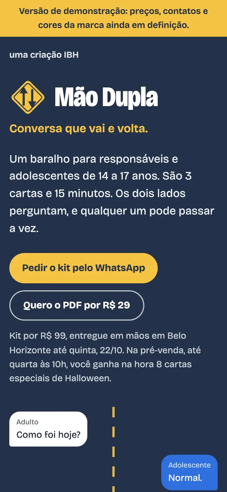
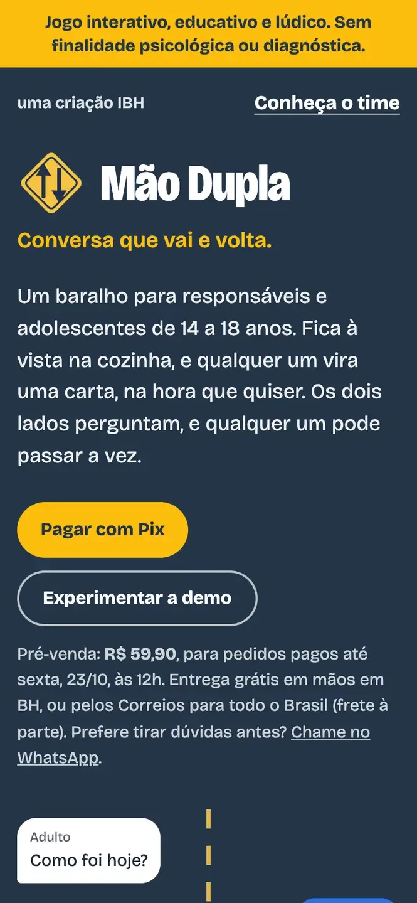
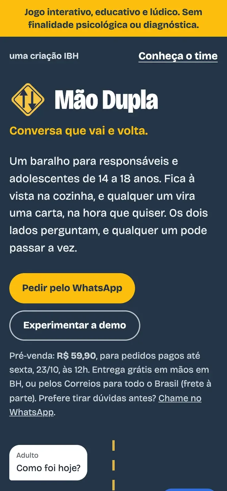
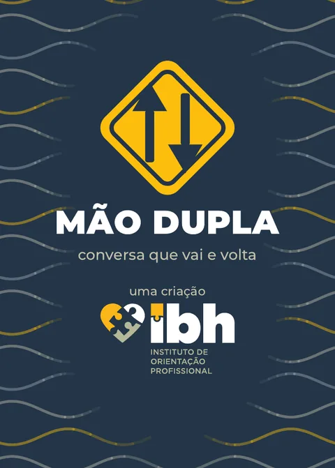
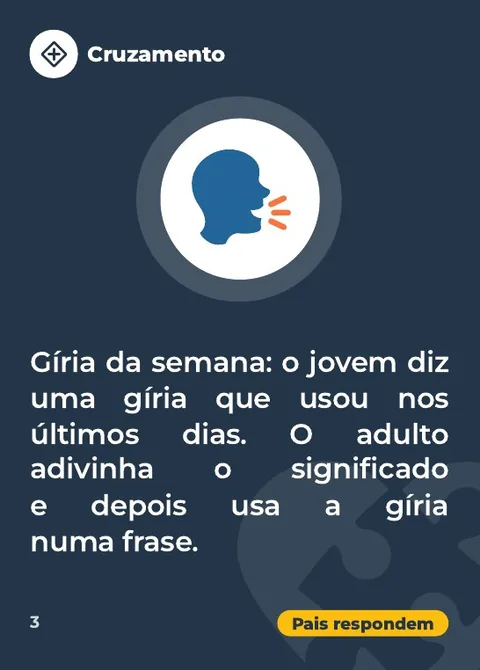
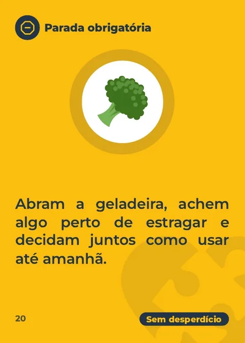
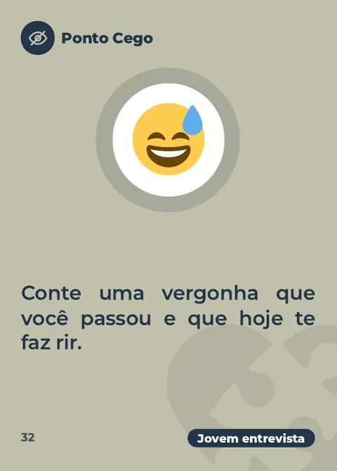
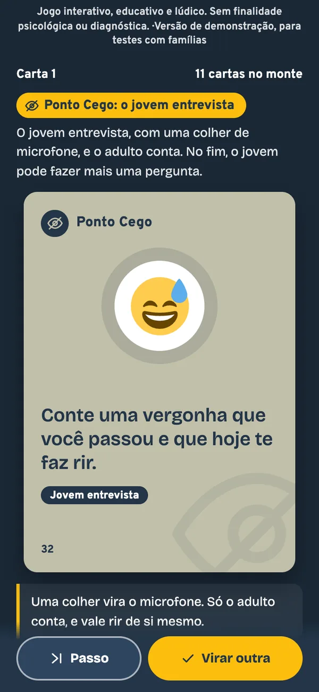

# Mão Dupla · prova de trabalho

> **Isto não é open source.** É um registro público do que eu construí no Mão Dupla, de 19 a 23/10/2026. O código, os arquivos da gráfica e o conteúdo completo das cartas ficam em repositório e pastas privados. Nada aqui tem licença de uso.

*In English: proof of work for Mão Dupla, a conversation card deck for parents and teens that our team built and sold in five days at Empretec (Sebrae, Belo Horizonte). Not open source; no code is published here.*

O **Mão Dupla** é um baralho de conversa para pais e filhos de 14 a 18 anos, uma criação IBH. Ele foi a nossa Empresa CRIA no Empretec do Sebrae em Belo Horizonte: o negócio de verdade que cada time monta e opera durante o seminário. O time foi a Aline Andrade, sócia do IBH, o Mario Filippetto e eu.

*Jogo interativo, educativo e lúdico. Sem finalidade psicológica ou diagnóstica.*

## O resultado

| | |
|---|---|
| **Meta** | 39 kits, o tamanho da primeira tiragem |
| **Vendidos** | 60 kits a R$ 59,90, 54% acima da meta |
| **Faturamento** | R$ 3.594, o maior da turma |
| **Doação** | 3 kits (5%): cada sócio abriu mão do lucro de 1 |
| **Site** | mais de 150 visitantes de 19 a 23/10 (Vercel Analytics) |
| **Prêmios** | do time, empresa com o maior faturamento total da turma; meu, um prêmio individual de superação |

## O que eu fiz

A ideia veio da Aline. O Mario ficou com a gráfica e a entrega. Eu fiquei com o produto, o site, a demo, os números e o pitch. A venda foi dos três: mensagem 1 a 1, vídeo para a própria rede e conversa olho no olho.

- **O baralho.** Sete versões em três dias, da v1 à v7. A final tem 36 cartas, 34 de jogo e 2 de apoio, em 2 folhas A3 frente e verso, sem sobra. Os arquivos da gráfica saíram por script.
- **O site de pré-venda.** No ar no primeiro dia, antes de existir uma carta impressa. Teve 28 links rastreados por sócio e por canal, passagens que contam o clique antes de abrir o WhatsApp ou o Pix, e mais de 1.500 verificações nos testes automáticos. O [histórico](HISTORICO.md) tem os 30 commits, com data e hora.
- **A demo.** Uma versão do jogo que roda no celular.
- **Os vídeos.** Um por sócio, para a própria rede, editados por código, com legenda e trilha original. As cenas geradas por IA são ilustrativas.
- **O pitch.** Um HTML que roda sozinho em 2 minutos cravados, com MP4 de reserva. Eu o apresentei sozinho, na sexta às 8h20.
- **Por trás de tudo.** 40 scripts Python, com cerca de 9 mil linhas, para gerar tudo de novo quando uma decisão mudava. E ela mudou muito: o preço foi de R$ 99 a R$ 59,90, e a tiragem, de 39 para 60.

## O site no tempo

A página de pré-venda mudou junto com as decisões. As três capturas foram refeitas a partir do histórico do código. Clique numa imagem para ver a página inteira. Os dados de pagamento e os telefones estão ocultos.

| Seg, 19/10 | Qua, 21/10 | Qui, 22/10 |
|---|---|---|
|  |  |  |
| A primeira página, ainda marcada como versão de demonstração: kit a R$ 99 e PDF a R$ 29. | A pré-venda: o kit a R$ 59,90, com as 36 cartas da v7, e o Pix na própria página. | A tiragem quase esgotada: sai o botão do Pix, e todo pedido passa pelo WhatsApp. |

## O baralho

Não tem tabuleiro, ponto nem hora marcada. O baralho fica à vista na cozinha, e qualquer um vira uma carta quando quiser. A regra de ouro: **os dois lados perguntam**.

O verso e três das 36 cartas, uma de cada categoria: Cruzamento, Parada Obrigatória e Ponto Cego.

A demo, com uma carta virada.

## Como a IA entrou

Usei a IA como uma equipe de produção: Claude Code com agentes em paralelo, Whisper no próprio computador para as legendas, e Google Flow e Gemini para cenas curtas de vídeo. As tarefas eram fechadas, as regras vinham escritas antes, e tudo era conferido no fim.

A IA não vendeu, não ouviu os pais e não decidiu. Preço, lote, cartas cortadas e o que entrou no pitch foram decisões do time, com números.

## Links

- O site: [gabrielbrina.com.br/maodupla](https://gabrielbrina.com.br/maodupla/)
- A demo: [gabrielbrina.com.br/maodupla/demo](https://gabrielbrina.com.br/maodupla/demo/)
- O vídeo do pitch: [gabrielbrina.com.br/maodupla/pitch](https://gabrielbrina.com.br/maodupla/pitch)
- O estudo de caso completo, com o que aprendi no Empretec: [gabrielbrina.com.br/empretec-2026](https://gabrielbrina.com.br/empretec-2026/)

## O que não está aqui

Não estão aqui o código-fonte, os arquivos da gráfica, o conteúdo completo das cartas, os dados de quem comprou, as conversas do time e o conteúdo das aulas do Empretec.

## Direitos

O Mão Dupla é uma criação IBH. Textos e imagens deste repositório: todos os direitos reservados. Ilustrações das cartas: Twemoji (Twitter, Inc. e colaboradores), licença CC BY 4.0.
